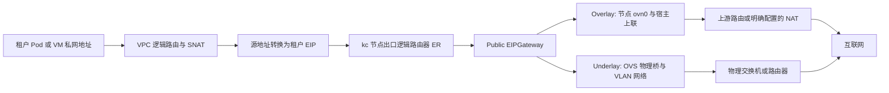

# 租户 VPC SNAT 方案：Overlay 与 Underlay

> 2026-11-04 网络合同更新：本文件中的网络状态、Ready/时效准入、Attachment 释放、SG 应用及 LB 生成物验收条款以[网络状态消费规格 v3](cr-observation.md)为准；方法/字段变更见[实施方案](../plans/network-management-simplification.md)。实际验证只见执行状态。

> 2026-09-14 部分规则由[统一方案](vpc-connectivity-lb.md)接替：每 VPC 的 SNAT 按内网/公网分别限制，EIP 占用覆盖 SNAT/LB，VPC 新增基础内网生命周期。下文保留为 d8835a22 已有实现的来源；未冲突的 Public 申请/启停/解绑/释放和平台模式规则继续适用，不把新方案当作已实现。

日期：2026-09-10；版本：1。本文定义 Network 的公网地址申请和 VPC SNAT 增量方案。用户已确认的模式、namespace 和权限要求在本文固化；接口名称、一期数量限制、持久模型和状态表达属于本次形成的工程设计，不代表已经实现或逐项验收。

本文承接 [VPC/Subnet 规格](vpc-subnet.md)、[持续观察规格](cr-observation.md)及既有 [ADR](../START-HERE.md#架构决定)，不改写这些模块已完成的验收边界。实现顺序见 [实施计划](../plans/vpc-snat.md)，实际命令与 YAML 见 [操作手册](../kc-public-egress-manual.md)，当前状态只维护在 [执行状态](../execution/status.md)。旧附件仅为背景，Provider 字段以固定 kc 源码和实际运行结果为依据。

## 1. 目标与一期范围

租户从平台申请 EIP，将其绑定到自己的 VPC，使该 VPC 下已正确接入的私有 Subnet 工作负载能够访问互联网；租户可以停用、重新启用、解绑和释放 EIP。平台管理员负责出口网络、EIPGateway 和 Public 地址池初始化，租户无需看到 Public Subnet 或物理网络。

一期采用以下明确限制，避免 kc 中重叠全 VPC SNAT 规则的优先关系进入产品契约：

- 一个 VPC 最多有一个尚未删除的 SNAT 绑定；绑定停用、degraded、deleting 或结果未知时也占用该位置。
- 一个 EIP 最多有一个尚未删除的产品绑定。先解绑再换绑；不提供原地换 EIP、换 VPC 或跨模式迁移。
- SNAT 覆盖整个 VPC，Provider `spec.cidrs` 省略；暂不开放子网级/指定 CIDR SNAT、多 EIP 出口或优先级。
- IPv4、单集群；VPC/Subnet 仍使用既有私有网络模型。Overlay/Underlay 是 **Public 出口地址池** 的属性，不把租户私有 Subnet 改为 Underlay。
- 普通容器先验收。Underlay 方案纳入本文，实测后续单独进行；VM、IPv6、HA、容量、DNAT/FIP、LB 绑定和公网入站能力不由本方案推导。
- 本轮按独立 Goal 实现 Network 后端并自动测试；合格 kc 上的 Overlay 经 Network 接口验收。Underlay 物理测试延期，ANI Gateway、kc 修复/升级、配额与 IAM 接线不在本轮修改范围。

历史事实：2026-09-10 kind 实测中，新建与重新启用的 Overlay 原始出网失败；补齐一条测试路由下一跳后的双 worker HTTPS 对照成功。完整证据及限制见 [实测记录](../execution/records/KC-OVERLAY-20260910T114200Z/README.md)。该对照不能作为“现有 kc 已可直接上线”的依据。

## 2. 所有权、资源及命名空间

Network 保存产品身份、平台出口配置、租户归属、占用关系、操作和恢复义务；kc 负责 IPAM、CR 状态及 OVN/OVS 下发。Gateway 负责产品入口和已授权租户上下文，实例 owner 负责 Pod/VM 接入与实际工作负载。Network 不直写 OVN、不用 SSH/iptables 充当产品执行路径，不代替实例 owner 创建探测 Pod。

| 产品概念/动作 | kc 映射 | 归属及 scope |
|---|---|---|
| 查询可用物理网卡 | 节点网卡事实与 kc 接管状态 | 平台，只读管理员接口 |
| 接管已准备接口 | Node 组标签与 `VlanNetwork.spec.vClusterName/devName/vlanID` | Res 管理逻辑占用与组；KCN 执行接口接管 |
| VLAN 二层网络 | `VlanNetwork` | Cluster 资源，不填 namespace |
| 平台出口网关 | `EIPGateway` | Cluster 资源，不填 namespace |
| Public Address Pool | `Subnet(type: Public)` | 平台，固定 `kcn-system`；不进入租户私有 Subnet CRUD |
| 租户 VPC | `VPC` | 目标租户 namespace；VPC 没有 `spec.type` 字段 |
| 租户 Subnet | `Subnet(type: VPC)` | 与 VPC 相同的目标租户 namespace |
| 租户 EIP | `EIP` | 目标租户 namespace，跨 namespace 引用平台 Public 池 |
| VPC SNAT Binding | `Snat` | 与 EIP、VPC 相同的目标租户 namespace |

平台 Public 池的 `allowedNamespaces.from` 固定 `All`。这仅允许 kc 跨 namespace 使用该池，不是租户访问平台 API、查询池详情或直接写 Kubernetes CR 的授权。租户不获得 kc CR 写权限。All 也不是“仅允许申请 EIP”的细粒度限制；实例 owner 只接受本租户私有 Subnet 的接入结果，不能允许租户绕过 API 直接把工作负载接入平台 Public 池。

`tenant_id`、namespace、Actor 与 Direct Caller 的规则：

1. 普通租户入口由 Gateway 从当前租户上下文补全 `tenant_id`；未确定活动租户就拒绝，不使用空租户或平台租户。公开普通租户 body 不增加自由覆盖 `tenant_id` 的能力。
2. 管理员代租户初始化时显式指定目标 `tenant_id`，先校验代办权限，再调用相同的租户用例；资源归属仍是目标租户，Actor 保留管理员。采用独立管理员路径，不把“传了 tenant_id”当作管理员授权。
3. Network 内部 RPC 继续要求非空 `tenant_id`，按既有持久租户→namespace 映射传给 Provider。EIP/Snat/VPC/私有 Subnet 的 Kubernetes 写入必须显式带该 namespace；客户端不能自由选择另一个 namespace。
4. 绑定必须同时验证 tenant、cluster、namespace、产品资源身份、Provider 名称及已记录 UID。名称相同或同 namespace 本身不构成授权。跨租户目标统一按不存在处理。
5. `Public Subnet` 固定 `kcn-system` 由 Network 后台填写；不是由 Kubernetes 将错误 namespace 中的对象自动迁移。
6. Provider 名称使用全局唯一产品 ID 派生的 DNS 合法名称，不用用户显示名；同租户允许资源显示名重复。标签只帮助定位，不替代持久映射和 UID 校验。

[ADR-0003](../adr/0003-defer-workload-authentication.md)仍适用：目前未验证的调用归因不能冒称真实鉴权。受控测试可显式注入租户，但实际对租户/管理员开放入口前必须接入相应可信授权链。

## 3. 两种出口模式与实际数据路径

| 维度 | Overlay Public | Underlay Public / 用户定义的 VLAN 模式 |
|---|---|---|
| Public 池 `underlayConfig` | 整个字段省略，不能写空对象 | 必须配置二层网络与物理下一跳 |
| VlanNetwork | 此出口不需要 | 必须，`vlanID: 0–4094` |
| VLAN 0 | 不用于表达 Overlay | 表示物理口不带 tag，仍属于本方案 VLAN/Underlay 模式 |
| VLAN 1–4094 | 不适用 | 表示物理口带对应 tag；交换机必须配合 |
| 出口承载 | OVN/OVS、必要的 Geneve 跨节点传输、节点宿主网络及上游 | OVN 逻辑出口、OVS 接管物理口、指定 VLAN/无 tag 二层网络、交换机/路由器 |
| Public `gatewayIP` | OVN 在 Public CIDR 内的接口地址 | 同左；须与物理网关地址不同 |
| 物理下一跳 | 来自节点及上游路由配置，不能填到 Public `gatewayIP` 冒充 | `underlayConfig.gatewayIP`：该物理段内真实交换机/路由器地址 |
| 回程条件 | 上游到 Public CIDR 的路由，或完整的上游 NAT/状态回程 | 上游到 EIP 所在物理网络的路由及相应二层邻接、ARP/过滤配置 |
| 后续验收 | 修复已知缺陷后重测原始流程 | 后续准备真实网卡/VLAN/网关环境，再独立实测 |

**EIPGateway 没有 `type: overlay/underlay` 字段。** 两种模式都使用 `scope: Public`、`egressType: Host`；当前 CRD 仅支持 Host。`egressType` 描述 Overlay 出口方式，Underlay 使用其子网物理路由配置。本方案不使用尚未实现的 `Gateway` 类型或 `gatewayConfig`。

新建 Public 地址池省略 `gateway_id` 时，Resource 在同一受理事务中为该池创建一个专属受管 EIPGateway，并持久保存引用。后台先等待网关真实就绪，再创建 Public Subnet；重试和重启复用原身份。受管网关不能被其他池引用或单独删除。删除地址池时先确认 Public Subnet 消失，再清理其受管网关，二者清理完成后池删除操作才成功。等待网关期间也允许删除池；原创建操作以 `SUPERSEDED_BY_DELETE` 结束，结果未知的外部创建仍须由原 UID 和直接观测消解，不能按未发送处理。

兼容既有 `gateway_id` 显式引用：其网关可共享，删除池不回收网关；已有池不自动认领为受管网关。产品记录每个池的模式和明确引用，不根据名称相似自动选择。同一物理口/VLAN 组合不创建冲突的 VlanNetwork；当前 kc 一个 VlanNetwork 只允许一个 Subnet 占用。

图表示逻辑处理路径，不保证每次都经过 Geneve，也不保证 ER、工作负载和物理出口在同一节点。不同 VPC 可复用私有 CIDR，但出口池须避开基础设施保留地址，并校验共享出口路径没有地址冲突。

SNAT 将租户工作负载私网源地址转换为 EIP，回包由有状态转换返回发起连接的工作负载；不因此向公网开放主动入站。若 EIP 池使用私网地址，上游仍须明确提供 NAT，互联网看到的是上游公网地址。测试中的实际链路是 `10.241.10.2 → 10.250.200.2 → 172.18.0.4 → 139.198.29.154`；前两次转换有节点抓包，最后公网地址由外部服务返回，上游各跳未逐一抓包。

## 4. 平台管理员初始化

### 4.1 Underlay 的手工网卡配置与二层网络

管理员准备接口、物理交换机和 VLAN 连通条件，按[二层网络合同](kcn-v09-underlay-flow.md)提交所选虚拟交换机、device_name 与 VLAN。Res 保留自己的节点选择/原 UID、组标签归属、设备槽位、引用和版本保护，不部署网卡采集器或第二次物理审批。

Worker 按原 UID/resourceVersion 合并自己拥有的组标签并声明 VlanNetwork；KCN 负责接口、OVS 和内部接管。Res 消费该 VLAN 的 Initialized，不把完整节点设备注解、CNI/Node 健康或物理接口状态重新合成为 Ready，也不修改 managedDevices、共享路由或底层规则。

声明失败、部分管理写入和未知请求沿原记录恢复，不通过隐藏重建、改标签触发或重启组件兜底。VLAN 删除以自己的原声明和逻辑引用结束，不承诺物理接口已归还；实际出口诊断按管理员显式操作记录。

### 4.2 先创建 EIPGateway

Public 地址池显式引用已登记的 Cluster EIPGateway。两种模式保持 scope=Public、egressType=Host，不虚构 Overlay/Underlay type 字段；status.localIP 是原生系统互联输出，不是租户 EIP 或上联地址。

Res 维护网关产品身份与声明，运行状态直接采用自身 Ready，不因 localIP/router 未报告或内部依赖诊断另造 Ready。提供方缺陷、首次支持条件和实际连通验收分别记录，不进入每次管理请求的附加证明。

### 4.3 创建 Public 地址池

以下是平台产品输入到 kc 的映射，完整 YAML 只维护在操作手册，避免出现第二份独立操作版本。

| 管理员输入/后台字段 | 如何取值及映射 |
|---|---|
| `mode` | 平台地址池的 `overlay` 或 `underlay`；后台据此决定是否生成 `underlayConfig`，不写入不存在的 EIPGateway type |
| `gateway_id` | Network 中的平台网关 ID；解析为 `Subnet.spec.gateway=<EIPGateway名>`，不填 IP 或 namespace/name；不使用 kc“列表第一项”默认选择 |
| `cidr` | 现场分配的真实出口 CIDR，映射 `cidrBlock`；不得与其他 Public 池、系统服务/互联段、节点/Service 等基础设施地址冲突 |
| `ovn_gateway_ip` | 本 Public CIDR 内预留给 OVN 的接口地址，映射 `gatewayIP`；不是工作负载私有 Subnet 的网关 |
| `excluded_ips` | 管理员声明的单地址或 `起始..结束` 范围，包含 OVN、交换机、已有设备等保留地址；检查范围落在 CIDR，kc IPAM 承担最终分配和冲突判定 |
| `vlan_network_id` | Underlay 必填、Overlay 禁止；后台解析为 `underlayConfig.vlanNetwork` |
| `upstream_gateway_ip` | Underlay 必填；真实物理网关，映射 `underlayConfig.gatewayIP`；须在该物理段内，与 OVN gateway 不同并加入排除列表 |
| `metadata.namespace` | 后台固定 `kcn-system`，管理员无需传租户 namespace |
| `type / ipVersion / allowedNamespaces` | 后台固定 `Public / IPv4 / {from: All}` |
| `enableDHCP / natOutgoing` | 池只分配 EIP，DHCP=false；不靠 `natOutgoing` 为普通租户 VPC 开公网 |

Underlay 的平台参数和逻辑引用在受理时冻结；池运行状态直接采用自身 Ready，不追加 underlayState、notReadyNodes、chassis 或 Node/CNI 健康合取。Overlay 不生成 Underlay 配置。物理接口、ARP、回程等由管理员显式诊断，不成为平台按本服务管理意图提交声明的重复验收。

一期不提供原池 CIDR、模式、网关、排除范围或 VLAN 的在线改写；新配置使用新池并按明确业务迁移处理已有引用，不把既有 EIP 隐式迁移到新出口。

### 4.4 出口验收、开放分配和默认池

池默认不接受新分配；管理员按当前权限、产品配置、版本和幂等规则开放。分配开关、默认池与当前原生状态分别表达，运行准入不追加 Provider Ready、观测年龄、镜像/拓扑 fingerprint 或人工 verification。

默认池切换仅影响后续首次受理；既有 EIP 保留原池、地址与配置，未知分配沿同一意图恢复，不切池或换名。关闭分配只阻止新申请，不撤销已受理任务，不删除或解绑已有地址。产品不存在、scope 错误、管理关闭、引用/配置冲突按自身业务错误拒绝。

RecordPublicPoolVerification/RecordIntranetPoolVerification 只保存管理员实际材料；不触发 provider 操作，不替换当前 operation，也不因材料过期使资源或动作失效。开放分配不宣称真实出口已经验收；物理连通、DNS 和回程按相应环境单独记录。

## 5. 租户申请与绑定流程

1. VPC/Subnet 使用当前产品接口和同租户管理引用；工作负载由其 owner 创建，Network 不接管 Pod/VM。
2. 新 EIP 在永久幂等重放之后选择开放的默认 Public 池，冻结 pool ID/版本、cluster/namespace、稳定原生名和请求意图。IPAM 由 KCN 负责，Res 不另分配 IP。
3. EIP 状态直接采用自身 Ready，地址只登记原生已报告输出；没有地址不另外拼接一个失败或准入门槛。
4. Public SNAT 受理核验 tenant/placement、VPC 与 EIP 管理状态、配置和唯一产品占用，不依赖 VPC/池/网关健康、观测时效或基础 Intranet。事务内保留 VPC 对应用途和 EIP 的唯一引用，随后声明原生 Snat。
5. 启用/停用沿自己的声明和本次意图推进；原生 phase 与 applied 输出决定结果。停用保留绑定和 EIP 占用，不当作解绑。
6. 解绑正常删除登记的原 Snat，原对象退出后释放自己的绑定关系；不向 EIP、Nat/Service 或底层网络补作清场证明。独立 EIP 本体保留，显式删除才结束其生命周期。
7. EIP 删除先检查 Res 未释放的产品引用，再按原 UID 删除；原对象 NotFound 或同名替换结束原身份，不碰替换对象，不等待物理地址回收。

创建、更新与删除保留幂等、租约、版本、原 UID 和未知写恢复；VPC 删除仍须完成自己的产品子资源/引用责任。实际调用顺序与字段见[统一产品合同](vpc-connectivity-lb.md)，状态与删除唯一规则见[网络 v3](cr-observation.md)。

## 6. 产品 API 增量设计

以下定义新增接口的目标行为；当前接线和验证结果只看执行状态。沿用 `/api/v1`、`network.v1`、现有名称/描述校验、错误封装、cursor 及 UTC 时间格式；本仓按固定流程生成 Proto/gRPC 客户端；ANI OpenAPI 接线属于独立范围。Provider 字段仅存在管理员视图或内部 adapter 中。

### 6.1 平台管理员能力

| 能力/RPC 草案 | 关键输入与输出 |
|---|---|
| `CreateVlanNetwork / Get / List / Delete` | 目标集群、交换机、手填 device_name 和 VLAN ID；KCN 接管、完整节点身份和逻辑占用检查 |
| `CreateEgressGateway / Get / List / Delete` | 平台网关名称；本期固定 Public/Host，内部字段隐藏于租户 |
| `CreatePublicAddressPool / Get / List / Delete` | 第 4.3 节输入；异步资源状态；池拓扑、容量原因仅管理员可见 |
| `SetPublicPoolAllocationEnabled / SetDefaultPublicPool` | 指定平台池 ID、并发版本和幂等键；开放须有对应模式验收依据，切换不迁移已分配 EIP |

网卡发现、独立设备登记/查询和退出 RPC/HTTP 入口已移除；交换机内部设备只保留逻辑身份与占用，不对管理员暴露独立登记步骤。

这些能力使用独立管理员 service/授权面及 `GetPlatformOperation` 查询，不向现有租户 `CreateSubnet` 添加 `type=Public` 绕过所有权。平台记录、操作、幂等使用平台作用域；不往租户表塞空/虚构 tenant_id 以绕过非空约束。最小写权限与网卡接管能力留在基础设施 adapter，不把节点 root 能力暴露给普通租户服务入口。

### 6.2 租户及管理员代办接口

| 拟新增 REST | 内部 RPC | 语义 |
|---|---|---|
| `POST /api/v1/networks/eips` | `CreateEIP` | 名称、描述、idempotency_key、可选 security_group_ids；安全组与地址原子受理，异步分配，返回 EIP 受理快照与 last_operation_id |
| `GET /api/v1/networks/eips` / `GET /api/v1/networks/eips/{id}` | `ListEIPs / GetEIP` | 仅当前租户，列表/详情不返回平台池和节点拓扑 |
| `DELETE /api/v1/networks/eips/{id}` | `DeleteEIP` | 仅未绑定 EIP；进行中重复调用返回同一删除操作 |
| `POST /api/v1/networks/vpcs/{vpc_id}/snat` | `BindVPCSnat` | body `eip_id,idempotency_key`；创建全 VPC 绑定并启用 |
| `GET /api/v1/networks/vpcs/{vpc_id}/snat` | `GetVPCSnat` | 查询当前非 deleted 绑定；无绑定返回 404 |
| `GET /api/v1/networks/vpc-snat-bindings/{binding_id}` | `GetVPCSnatBinding` | 按稳定 ID 查询，保留 deleted 墓碑，供 Location 与历史查询使用 |
| `PATCH /api/v1/networks/vpcs/{vpc_id}/snat` | `SetVPCSnatEnabled` | body `binding_id,enabled,expected_version,idempotency_key`；只能变更启停 |
| `DELETE /api/v1/networks/vpc-snat-bindings/{binding_id}` | `DeleteVPCSnatBinding` | 按不可重用的绑定 ID 解绑，防止迟到请求删掉同 VPC 的新绑定 |

管理员代办采用 `/api/v1/admin/tenants/{tenant_id}/networks/...` 对应上述资源路径，并包括现有 VPC/Subnet 初始化动作；经管理员授权后重用相同 RPC/use case，不建第二份租户状态机。普通租户公开 body 继续不接受任意 tenant_id。平台基础设施 API 本身不要求租户身份。

创建 EIP/绑定返回 `201` 受理快照；新启停或解绑/释放返回 `202` 受理结果，operation 表明异步进度，未发生新操作的同意图重放返回原受理快照。EIP/绑定均有稳定 opaque ID，建议分别以 `eip_` / `snat_` 加 UUID 派生；列表分页和墓碑按既有规格。EIP、VLAN 网络、出口网关、公网及内网地址池列表返回 `items,next_cursor,total`；`total` 复用相同租户或集群、种类、可见性和筛选条件，不应用 cursor/limit，与本页数据来自同一只读数据库快照。节点网卡列表不分页，`total` 为节点筛选后的清单条数。新增 operation/resource kind 为 EIP、VPC SNAT 绑定及其实际变更，生成契约需显式扩展，不能把它们伪装成 CreateVPC。

响应增量：

- EIP：既有资源公共字段，加 `address`（未分配为空）、`binding_id`、`binding_state`（unbound/reserved/bound）；地址释放后仅作历史观测，不承诺仍属于该租户。租户不看到 pool ID、CIDR、gateway/node/namespace/CR 名。
- VPC SNAT 绑定：公共字段加 `vpc_id,eip_id,eip_address,desired_enabled,applied_enabled`；`applied_enabled` 未知时为空，不能回显期望值冒充已应用。`state=available` 表示本次配置已应用；停用后的展示为“已停用”，不会显示“已出网”。
- 如展示流量验证结果，另用 `connectivity_verification`，包含 `unknown/pass/fail`、验证时间、配置版本及明确验证范围；默认 unknown。平台池的抽样成功不能标记每个租户工作负载为已验证；过期或配置/绑定代次变化即失效。该字段不新增一个自动创建 Pod 的职责。

拟新增业务原因包括 `PUBLIC_EGRESS_NOT_READY`、`EIP_POOL_EXHAUSTED`、`EIP_IN_USE`、`VPC_SNAT_EXISTS`、`RESOURCE_BUSY`、`PROVIDER_IDENTITY_CONFLICT`、`PROVIDER_STATE_MISMATCH`。受理前错误按现有封装映射 400/404/409/503；受理后的 IPAM 耗尽或 Provider 错误写入 operation/resource 原因，不改写已经返回的受理响应。租户错误只给稳定脱敏说明，平台池名和原始 controller 日志仅管理员可见。

### 6.3 幂等与并发输入

CreateEIP、BindVPCSnat、启停分别使用 `(tenant_id, operation_kind, idempotency_key)` 的永久幂等域。先做当前身份/租户及无状态规范化，再查已受理记录，最后才检查动态池/资源状态。已受理的 EIP 申请不会因默认池切换而改分另一个池；默认池不参与重放时重新计算的请求指纹，而是首次受理时固定的分配目标。

启停指纹包含绑定 ID、目标 enabled 与 expected_version，重放先于当前版本比较。新命令按 expected_version 做 CAS；旧绑定 ID 即使 VPC 已重新绑定也不能指向新对象。已达到同一期望且实际已观测时可幂等返回原应用结果，不制造 Provider 写入；结果未知时继续原操作。

Delete 使用不可重用的 EIP/绑定 ID，天然按目标幂等；进行中重放继续原 operation。资源 deleting、同名 CR UID 变化或创建结果未知时，不释放占用、不换名字重新创建。

## 7. 观察、状态及完成条件

原生公开结果按[网络状态消费](cr-observation.md)逐类采用，不混用 Res 产品 version、通知 generation 与原生 observedGeneration：

| 对象 | 当前权威结果 | 管理完成边界 |
| --- | --- | --- |
| VPC/Subnet/EIP/地址池/网关 | 自身 Ready 三态；地址等输出按实际读取登记 | 不添加父健康、空地址、router、镜像或内部关系合取 |
| VlanNetwork | 自身 Initialized | 不等待节点、设备反馈或物理接管证明 |
| Snat | 自身 phase 与 applied 输出 | 本次配置结果独立于底层网络连通 |
| 自己声明的原对象删除 | 原 UID 不存在或同名已替换 | 结束原对象，不删除替换对象，不等自动子资源/地址物理清场 |

读错保留最后成功投影、原因、输出与 observed_at，任务记录 observation_error 并退避；无新事件或旧时间不自动使稳定结果失效。历史 operation 终态不改写，稳定任务停放，Deleted 退休。

通知只映射已登记的本服务目标，执行者精确 GET；不监听或反向扫描 Nat/Service 等内部链路来证明绑定。具体端口与实现入口见[出网用例](../../internal/biz/network/egress.go)、[受理事务](../../internal/data/network/egress.go)、[原生 adapter](../../internal/data/network/kc_egress.go)及[既有 worker](../../internal/biz/network/worker.go)。显式安装/流量诊断另存原版本与结果，不授权常规补偿。

## 8. 持久模型、删除保护与恢复

平台池/网关/VLAN 使用真实平台范围，租户 EIP/SNAT 带显式 tenant；跨关系保持同一 cluster/placement 和产品引用约束。EIP 只对应一个当前产品目标，VPC 内网/公网用途分别约束；SNAT 与 LB 共用 EIP 产品占用，不各建私有账本。

受理在本地事务保存资源、配置、operation、稳定原生名、永久幂等与待执行责任。外部调用在事务外，Finish 核对产品版本、租约和 epoch；已保存原 UID 不被同名新对象覆盖。结果未知时认回同一次意图，不改池、不换名、不清 pending 或伪造 unbound。

父 VPC、EIP、SNAT 和平台池引用按既定锁顺序协调；管理删除不忽略未释放引用或在途步骤。引用归零后删除自己的声明，不读取第三方 Nat/Service 或完整分配集合再次证明。池/网关/VLAN 的逻辑依赖按本服务关系收尾，不自动收养手工对象，不清理共享 Namespace。

真实 schema、约束与升级以[迁移源码](../../migrations)和当前查询为准；历史 0005 等版本保留原 checksum，后续 0032 已删除的证明列/关系表不再构成当前合同。必要业务身份、checkpoint 与历史回执保留，API 废弃字段号不重新占用。

## 9. 历史 kc 缺陷与验证边界

以下是 2026-09-10 固定源码与现场的历史结论，不推断当前部署版本仍存在或已经修复；新版本需按实际输入核验，不转成 Res 的运行时证明门槛。

| 历史缺口 | 当时依据及组件处理要求 |
|---|---|
| 新 EIPGateway 缓存遗漏 serviceIP | 固定源码 `EIPHandler.LoadGatewaySubnet` 只填 scope/subnets，`addEIPRoutesOnER` 将空 serviceIP 写为下一跳；已有现场双 worker 失败与单字段对照证据。kc 修复热加载及缓存有效性，空/未就绪网关不得成功下发路由；测试新网关、重启加载和 disable→enable。 |
| EIP 初次绑定跨 namespace 裸名匹配 | `selectBoundObj` 对 Nat/Snat/Service 的 List 使用裸 EIP 名索引且未限定 namespace。Network 同 namespace 和全局唯一 Provider 名是必要防线，不能宣称修复了 kc 的查询隔离；kc 需收紧候选范围并做同名跨租户负例。 |
| Snat 接受跨 namespace VPC 引用 | 解析 spec.vpc 的 namespace/name 后未强制与 Snat 相同。Network adapter 强制同租户同 namespace；kc 校验应补齐，对直接非法 CR 给出明确拒绝。 |

修复归属 kc-networking，不向本仓库添加 kc 实现任务。原始出口验收必须使用可追踪源码/镜像且不依赖手工下一跳修补；不能以“重启控制器后缓存碰巧完整”关闭新网关问题。Underlay 同样经过 ER→网关的公共路径，需携带同一修复验证；当前没有 Underlay 运行结论，也不能断言它不受该缺陷影响。

当时测试的条件性成功仅证明私有 EIP + 临时节点 NAT 的 Overlay 路径。Overlay 正式部署还须验证真实可路由地址/上游 NAT、回程及 DNS；Underlay 后续须核定物理端口和交换机，完成 VLAN 0 与带 tag 场景，不能在当前只有管理网卡的 kind 环境直接接管 eth0 来模拟物理公网。

## 10. 验收合同

每项分别记录 pass/fail/not_verified，包含 Network/kc 源码和实际镜像、集群、输入、命令、时间、预期/实际源地址及清理差异；不以 CR Bound 或 HTTP 请求已受理替代工作负载出网。

| ID | 必须证明的行为 |
|---|---|
| SNAT-V01 | 管理员手填已准备接口；无宿主库存仍可受理；逻辑占用、冻结节点配置身份与部分写入失败保护；不写 managedDevices 或他人配置；平台池/网关/VLAN 归属正确 |
| SNAT-V02 | 租户不能查询/修改 Public 池；All 只允许 Provider 跨 namespace 使用；管理员代办资源归属正确，普通租户伪造 tenant/ns 不越权；真实鉴权与受控注入结果分开 |
| SNAT-V03 | EIP 自动分配与实际 spec.ipAddress、池耗尽、默认池关闭/切换、未知结果恢复、同键重放与无重复分配；跨 tenant/cluster FK 负例 |
| SNAT-V04 | 并发两个 VPC 抢同 EIP、同 VPC 抢两个 EIP、绑定与删除竞态；disabled/failed/unknown 仍保留唯一占用；跨 namespace 同名 Nat/Snat/Service 不误绑 |
| SNAT-V05 | 完整 lifecycle：未绑定→绑定→停用→重启用→解绑→释放；每代 CR/UID/引用/generation 和产品状态吻合；迟到 Delete 不删除新绑定 |
| SNAT-V06 | Overlay 原始配置在控制器运行后新建网关，两 worker/同 VPC 两子网出网；证明私网源→EIP；如果有上游 NAT，明确最终源地址；不手改 OVN |
| SNAT-V07 | Overlay 正/负对照同时验证 VPC 内连通，避免以 Pod 未启动、镜像缺失、端点故障冒充隔离；外部节点控制与业务 Pod 探测分开 |
| SNAT-V08 | DNS UDP/TCP、域名 HTTPS/TLS、跨节点 MTU/较大响应及回程；Cluster DNS 在 intranetNetworks 时独立处理内部可达性，Public SNAT 不自动开放内网目的 |
| SNAT-V09 | Underlay 后续实测：VLAN 0 与至少一组 1–4094、真实物理口/OVS mapping、OVN/交换机两种网关、ARP、出口 chassis、外部源地址/回程和相同 lifecycle；错误 tag/下一跳的负例不能影响管理面 |
| SNAT-V10 | API/DB/Provider 故障、未知请求、Watch/status-only/旧缓存、同名异 UID及多 worker 恢复；Get/List 纯读；自身原生状态直接映射，读取错误保留，不拼接平台依赖 Ready，不提前释放自身未完成的 EIP 引用 |
| SNAT-V11 | 解绑不删 EIP、原 EIP 声明删除完成、VPC/池/网关/VLAN删除占用保护；清除测试 CR/路由/NAT并保留原有资源 UID/工作负载；共享 ER 等 Provider 残留差异明确记录 |

## 11. 依据与文档职责

- [领域词汇](../../CONTEXT.md)：EIP、Public 地址池及 SNAT 绑定的定义；本文负责增量规则。
- [手动操作手册](../kc-public-egress-manual.md)：管理员与租户完整 YAML/命令，以及固定 kc commit 的逐项源码链接；本文不重复维护另一套可执行模板。
- [2026-09-10 Overlay 实测](../execution/records/KC-OVERLAY-20260910T114200Z/README.md)：只读使用已完成证据，包含原始失败、对照、DNS 未完成和共享 ER 保留差异；本轮没有重跑。
- [源码输入](../execution/records/KC-OVERLAY-20260910T114200Z/source-snapshot.json)：Network `e481e968d3cc2f17bc4c6a736c438428519b09a0`，kc `a2245883eb2b46a998f041feb3ad0ed3f6cf7c60`；运行镜像与 kc 编译提交的精确关联尚未验证。
- 当前 [Network RPC](../../api/network/v1/network.proto)定义 VPC/Subnet/Attachment/VNIC 等能力；[Egress RPC](../../api/network/v1/egress.proto)、[平台默认出口](../../api/network/v1/default_vpc_egress.proto)与[平台 EIP](../../api/network/v1/platform_eip.proto)已分文件定义。生成契约不等于实现或现场验证，实际进度只见[执行状态](../execution/status.md)。

## 平台默认 VPC 出口查询与地址清单

平台默认出口固定作用于部署配置指定的 `kcn-system/kcn-cluster`，不接受调用者传入集群或 VPC 身份。`GetCurrentDefaultVPCEgress` 查询该集群/VPC 尚未退役的唯一出口；未配置返回 `RESOURCE_NOT_FOUND`，删除中的出口继续可见，完成删除后不再作为当前配置返回。创建、按 ID 查询和删除继续复用既有平台出口生命周期。

出口持久保存独立 `eip_id`，与原生 EIP 的 Provider 名称/UID 分开。平台 EIP 列表和详情包含该地址，`managed_by=system`、`scope=public`、租户为空，绑定目标为 `platform_default_egress`。列表计数、组合过滤和分页在同一个只读快照中完成；租户筛选不会包含该地址。它只能随平台出口删除而回收，不能从普通 EIP 释放接口单独删除。
